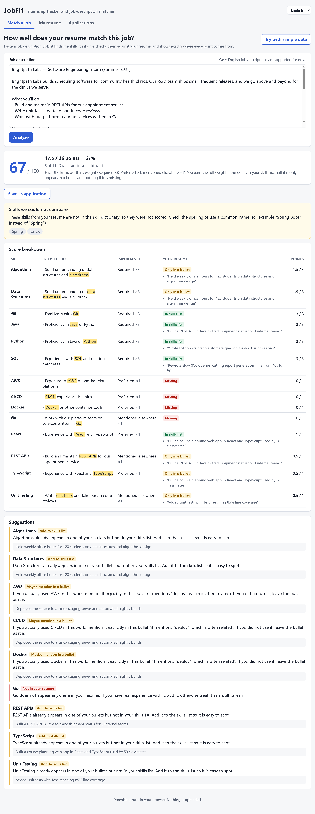
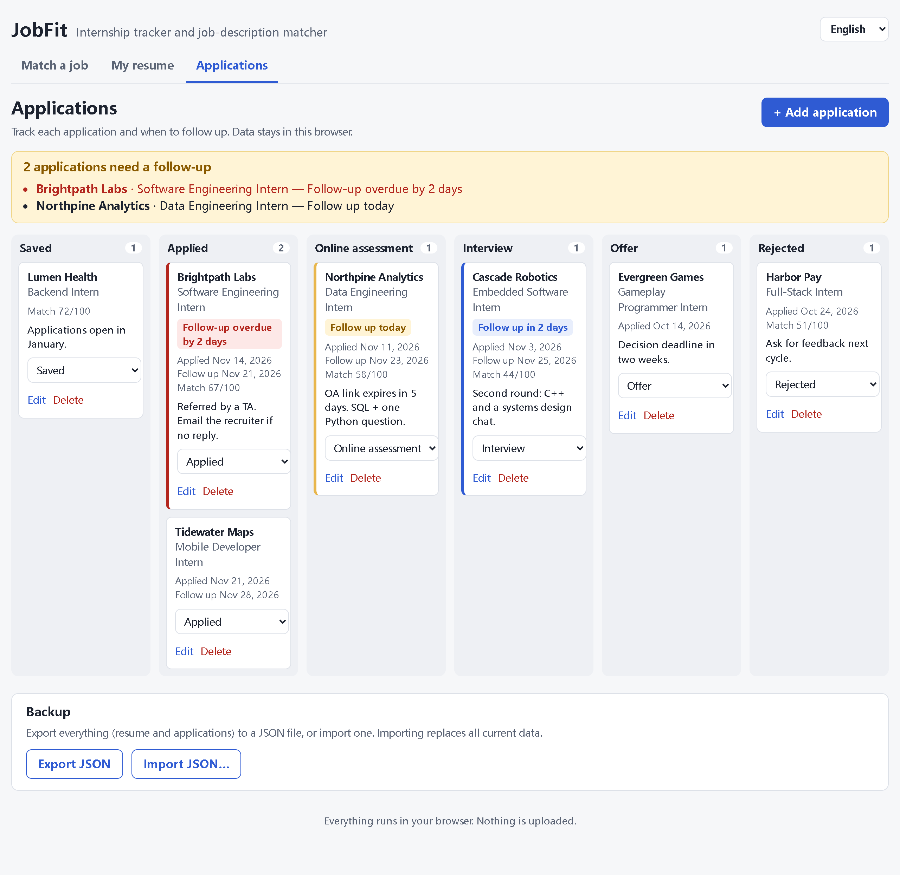
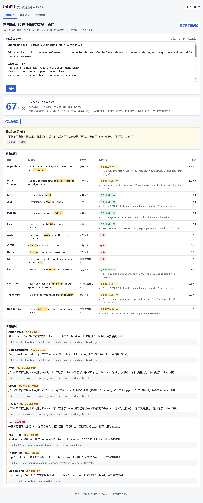

# JobFit

**An internship application tracker that also shows, line by line, how well your resume matches a job description.**

Live demo: _coming soon_ <!-- Replace with the deployed URL once the app is deployed. -->



## Features

- **Explainable match score.** Paste a job description (JD). JobFit finds the skills it asks for using a hand-written skill dictionary, weighs each one by the section it appears in (Required ×3, no section headings ×2, Preferred ×1, elsewhere ×1) and checks your resume for it. The breakdown shows the exact JD line and resume bullet behind every point.
- **Careful gap suggestions.** For a skill that is only in a bullet, it suggests adding it to your skills list. For a missing skill that may be related to one of your bullets, the advice is always conditional: *"If you actually used Docker in this work, mention it … If you did not use it, leave the bullet as it is."* It never tells you to claim experience you don't have.
- **Application board.** Track applications through Saved → Applied → Online assessment → Interview → Offer / Rejected, with follow-up reminders (overdue, due today, due within 3 days).
- **English and Simplified Chinese interface.** Switch at any time; the choice is remembered.
- **Backup.** Export everything to a JSON file and import it again. Imports are fully validated first; an invalid file changes nothing.





## Privacy

JobFit has no server. Your resume, applications and language choice are stored only in your browser's `localStorage` (keys `jobfit.resume.v1`, `jobfit.applications.v1`, `jobfit.language`). Nothing is uploaded. Clearing site data removes it, so use **Export JSON** to keep a backup.

## Tech stack

- **TypeScript** (strict) and **React 19**, built with **Vite**
- **Vitest** for unit tests, with V8 coverage
- **ESLint** (typescript-eslint with type information, React Hooks rules)
- **GitHub Actions** CI that runs every check in two time zones
- Runtime dependencies: `react` and `react-dom` only. Matching, scoring, date handling and validation are written by hand in `src/core/`.

## Run locally

Requires Node.js 26.13.1 or later in the 26.x line (see `engines` in `package.json`).

```bash
npm ci
npm run dev        # http://localhost:5173
```

Other commands:

| Command | What it does |
|---|---|
| `npm run build` | Production build into `dist/` |
| `npm run preview` | Serve the production build locally |
| `npm run lint` | ESLint; must report 0 errors and 0 warnings |
| `npm run typecheck` | `tsc --noEmit` over `src/`, `tests/` and `vite.config.ts` |

## Tests and coverage

```bash
npm test               # run all unit tests once
npm run test:watch     # re-run on file changes
npm run test:coverage  # tests + coverage report for src/core (text summary, HTML in coverage/)
```

The business logic in `src/core/` has 100% line, branch and function coverage (`npm run test:coverage` fails if any of these drops below 80%). The UI is checked by hand plus a few tests of its pure helpers and translation rules.

Date logic depends on the machine's time zone, so CI runs everything twice, with `TZ=UTC` and `TZ=America/Los_Angeles`. To do the same locally:

```bash
TZ=America/Los_Angeles npm test          # macOS, Linux, Git Bash
```

```powershell
$env:TZ = 'America/Los_Angeles'; npm test   # Windows PowerShell
```

## Project structure

```
src/
  core/       Business logic in plain TypeScript classes, no React: JD parsing, matching,
              scoring, gap suggestions, reminders, calendar dates, import validation.
    data/skills.json   The skill dictionary (names, aliases, related keywords)
  storage/    Repository interface, plus localStorage and in-memory implementations
  ui/         React components, grouped by page (match/, resume/, board/), and i18n/
tests/        Unit tests, mirroring src/ (core/, storage/, ui/)
scripts/      screenshot.mjs: regenerates the README screenshots
docs/         Design decisions, architecture, reading guide, interview notes
```

More detail:
- [docs/ARCHITECTURE.md](docs/ARCHITECTURE.md): layers, data flow, and why `core` has no React
- [docs/DECISIONS.md](docs/DECISIONS.md): every design decision, what was rejected, and what it costs
- [docs/READING_GUIDE.md](docs/READING_GUIDE.md): the order to read the code in

## Regenerating the screenshots

The screenshots use only the built-in fictional sample data (**Try with sample data** and **Load sample applications**). `scripts/screenshot.mjs` opens a headless Chrome or Edge with a temporary profile, so your own browser data is never used. It needs Node 22+ and no extra packages.

```bash
npm run dev    # keep this running in another terminal

npm run screenshot -- --view match --lang en --width 1280 --out docs/screenshots/match-en.png
npm run screenshot -- --view board --lang en --width 1280 --out docs/screenshots/board-en.png
npm run screenshot -- --view match --lang zh --width 1280 --out docs/screenshots/match-zh.png
```

If no browser is found, set `BROWSER_PATH` to your Chrome or Edge executable. The board's reminder dates are relative to the day you take the screenshot.

## Limitations

The JD parser only understands English job descriptions, and only recognizes skills in its dictionary. Data lives in one browser: two open tabs can overwrite each other, and there is no sync. The full list is in [docs/DECISIONS.md](docs/DECISIONS.md#known-limitations).
